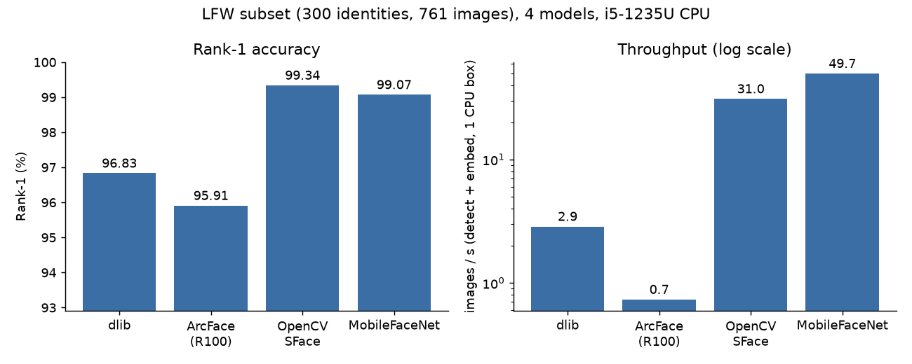

````md
# PhotoFinder Research Bench

A reproducible template for **offline face-based photo retrieval** experiments.

## What this repo gives you
- Multiple embedding models (plug-in style)
- Folder-based datasets + public benchmarks (e.g., LFW)
- Retrieval evaluation (Rank-1, Recall@K, MRR, etc.)
- ANN indexing (FAISS / HNSW) + rerank testing
- Sweep runner for **baseline + ANN knobs**
- Clean artifacts (JSON/CSV/MD) suitable for a research paper

> **Do not commit private face datasets.** Use public benchmarks (like LFW) or keep private datasets local.

---

## Repo structure
- `src/photofinder/` — core library + `photofinder` CLI
- `scripts/` — sweep runner + summary builder
- `runs/` — outputs (indexes, ANN files, metrics, summaries) **(do not commit)**
- `paper/` — claim → evidence table, outline, figures

---

## Quick start (CPU-only)
### 1) Create & activate venv

**Windows (PowerShell)**
```powershell
python -m venv .venv
.\.venv\Scripts\Activate.ps1
````

**macOS/Linux**

```bash
python -m venv .venv
source .venv/bin/activate
```

### 2) Install

```bash
pip install -U pip
pip install -e ".[base]"
```

Optional extras (only if your repo defines them):

```bash
pip install -e ".[dlib,onnx,hnsw]"
```

---

## Dataset format

### Simple folder dataset (recommended)

Expected layout:

```
data/<dataset_name>/images/<person_id>/<image_file>.jpg
```

Example:

```
data/my_event/images/abdul/IMG_001.jpg
data/my_event/images/abdul/IMG_002.jpg
data/my_event/images/hamza/IMG_010.jpg
```

### LFW funneled layout (benchmark)

If you use the standard LFW funneled structure:

```
data/lfw/lfw_funneled/<person_id>/<image_file>.jpg
```

---

## Core CLI (single run)

### 1) Build an embedding index

```bash
photofinder index --dataset data/lfw/lfw_funneled --model arcface_onnx --out runs/lfw_arcface
```

### 2) Evaluate retrieval (bruteforce)

```bash
photofinder eval-retrieval --index runs/lfw_arcface/index.npz --out runs/lfw_arcface --backend bruteforce --top-k 10
```

### 3) Build ANN (FAISS / HNSW)

```bash
photofinder build-ann --index runs/lfw_arcface/index.npz --out runs/lfw_arcface/_ann --ann-type hnsw --hnsw-m 32 --ef-construction 200
```

### 4) Evaluate retrieval (ANN)

```bash
photofinder eval-retrieval --index runs/lfw_arcface/index.npz --out runs/lfw_arcface/_ann --backend ann --top-k 10 --ann-k 500 --ef-search 128 --rerank on
```

---

## Sweeps (baseline + ANN knobs)

The sweep script automates:

* multiple models
* index build
* bruteforce retrieval eval
* ANN build + ANN eval across knob sets
* consolidated summary report (CSV + MD)

### Run a sweep (example)

```powershell
python scripts\photofinder_full_sweep_v8.py `
  --dataset data\lfw\lfw_funneled `
  --out-root runs\sweeps\lfw `
  --models arcface_onnx dlib_resnet_v1 opencv_sface mobilefacenet_onnx `
  --phases baseline ann_knobs `
  --top-k 10 `
  --fast `
  --continue-on-error
```

### Phases

* `baseline`
  Builds `index.npz` and runs bruteforce retrieval eval once per model.

* `ann_knobs`
  Builds FAISS ANN indexes and evaluates retrieval across ANN knob combinations (HNSW params, `ef_search`, `rerank`, etc.).

---

## Build a sweep summary (CSV + MD)

After runs exist under `runs/sweeps/<dataset>/...`:

```powershell
python scripts\make_sweep_summary.py `
  --run-root runs\sweeps\lfw `
  --out-csv runs\sweeps\lfw\summary_results.csv `
  --out-md runs\sweeps\lfw\summary_results.md
```

### Windows note (important)

If `summary_results.csv` is open in Excel, you may get:
`PermissionError: [Errno 13] Permission denied`

Fix: close the CSV and rerun.

---

## Outputs (what gets saved)

Each run folder typically contains:

* `index.npz` — embeddings + metadata
* `metrics_retrieval_bruteforce.json` — bruteforce retrieval metrics
* `_ann/.../index.faiss` — ANN index file
* `_ann/.../metrics_retrieval_ann.json` — ANN retrieval metrics

Sweep-level summaries:

* `summary_results.csv` — all runs in one table
* `summary_results.md` — human-readable report

---

## Results: model comparison (measured, CPU only)

Protocol: LFW funneled, `scripts/make_lfw_subset.py --people 0 --per-person 3` (all 1,680 identities with >=2 images,
first 3 images each = **4,261 images**). One face per image (`largest`), L2-normalised embeddings, **exact brute-force
cosine** retrieval, every image with at least one same-identity image is a query (leave-one-out against the rest of the gallery).
Rank-1 / Recall@5 / Recall@10 / MRR as in `src/photofinder/eval/retrieval.py`. Models run one at a time, nothing else heavy running.

**Throughput = images / wall-clock seconds of the indexing loop**: JPEG decode + face detection + alignment + embedding +
normalisation, batch size 1, per image, in a single Python process. It excludes model loading and the retrieval evaluation.
Hardware: Intel Core i5-1235U (10 cores / 12 threads), Windows 11, Python 3.12.4, onnxruntime 1.31 (CPU), OpenCV 5.0, dlib 20.0.1.

Full protocol (4,261 images, 4,240-4,254 queries per model):

| Model | Rank-1 | Recall@5 | Recall@10 | MRR | images/s |
|---|---|---|---|---|---|
| dlib ResNet v1 | 93.49% | 97.90% | 98.66% | 0.9547 | 2.85 |
| OpenCV SFace (YuNet detector) | 98.52% | 99.15% | 99.20% | 0.9879 | 32.4 |
| MobileFaceNet (w600k_mbf, YuNet detector) | 98.84% | 99.34% | 99.43% | 0.9907 | 64.9 |
| ArcFace R100 (glintr100) | not run on the full set (about 1.3 s/image here, ~90 min) | | | | |

MobileFaceNet vs dlib on the full protocol: +5.35 points Rank-1, **22.8x** throughput (64.9 / 2.85).

Reduced protocol so all four models fit (first 300 identities of the same subset, 761 images, 756-761 queries;
`results/subset300/`, chart `results/model_comparison.png`):

| Model | Rank-1 | Recall@5 | Recall@10 | MRR | images/s |
|---|---|---|---|---|---|
| dlib ResNet v1 | 96.83% | 99.34% | 99.47% | 0.9785 | 2.86 |
| ArcFace R100 (glintr100, dlib 5-pt chip alignment) | 95.91% | 98.55% | 98.68% | 0.9714 | 0.73 |
| OpenCV SFace | 99.34% | 99.47% | 99.61% | 0.9940 | 31.0 |
| MobileFaceNet | 99.07% | 99.21% | 99.21% | 0.9914 | 49.7 |



Notes:
* Small samples: on 761 images one query is ~0.13 points, so SFace vs MobileFaceNet on the reduced set is a tie.
* ArcFace ranks last here; this reflects this repo's detector/alignment pipeline and preprocessing, not necessarily the model's ceiling.
* Throughput varies by a few percent run to run (MobileFaceNet measured 64.9 img/s on the full set, 49.7 on the reduced one).
  Earlier numbers measured while other jobs shared the CPU (e.g. 0.33 s/image for MobileFaceNet) are not valid.
* Raw files: `results/model_comparison.{csv,json}` (full), `results/subset300/model_comparison.{csv,json}`, per-model `results/**/raw/*.json`.
* Reproduce: `python scripts/model_comparison.py --dataset <subset> --out-root runs/cmp --models mobilefacenet_onnx`, then `--collect`;
  model paths via env vars (`ARCFACE_ONNX_PATH`, `MOBILEFACENET_ONNX_PATH`, `OPENCV_YUNET_PATH`, `OPENCV_SFACE_PATH`, `DLIB_*`).

---

## Tests

```bash
pip install -e ".[base,faiss,test]"
pytest -q
```

26 tests (no model downloads): retrieval metrics on hand-computed toy cases, exact vs FAISS flat/HNSW parity on random vectors,
sweep-grid and config parsing. They run in CI on Python 3.11 and 3.12.

---

## Git hygiene

### Recommended `.gitignore`

```gitignore
runs/
*.npz
*.faiss
*.onnx
```

---

## License

MIT (template). Replace if needed.
